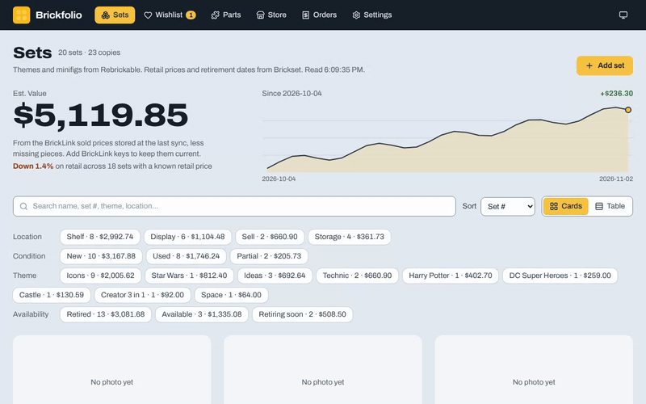
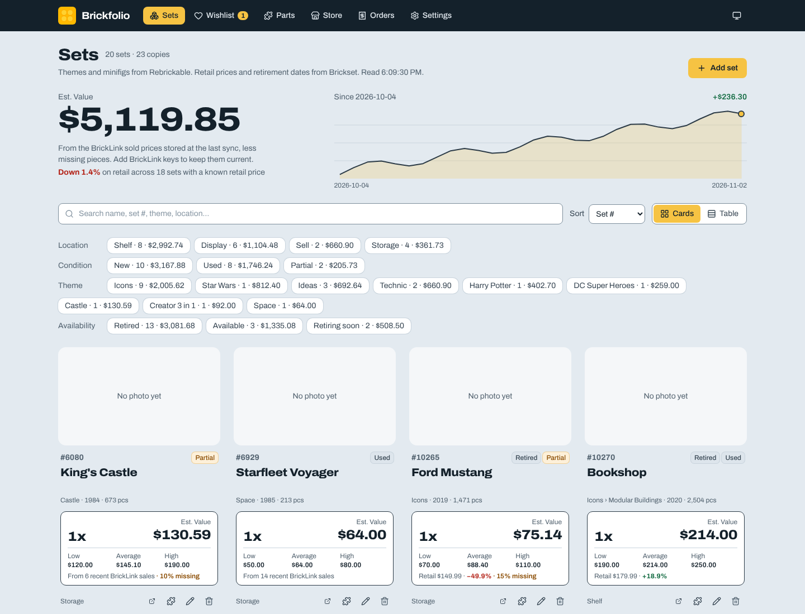
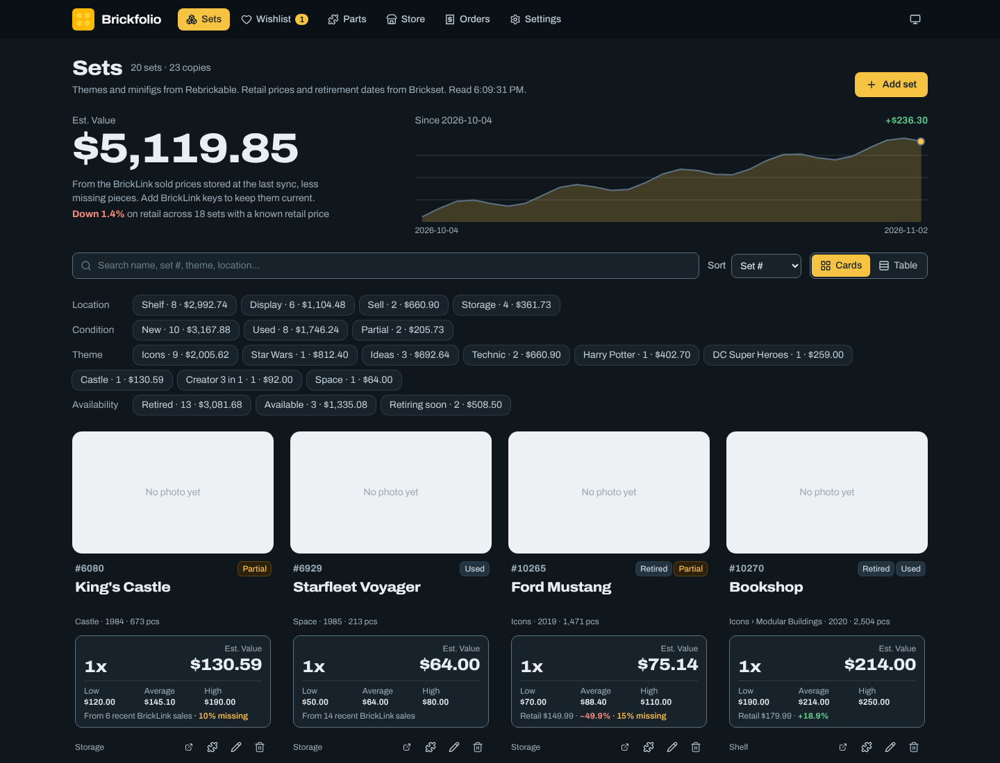
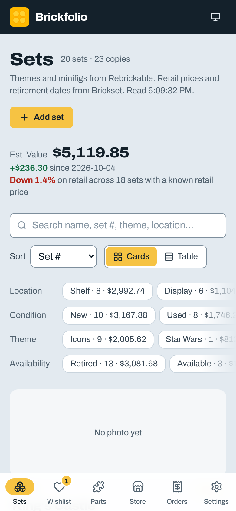
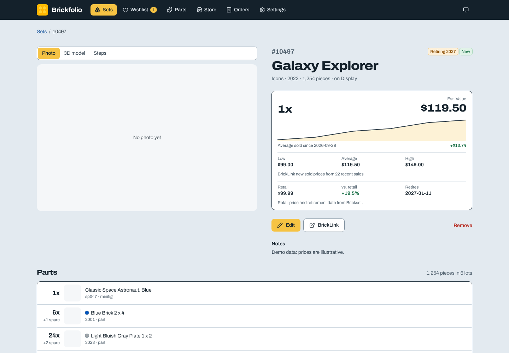
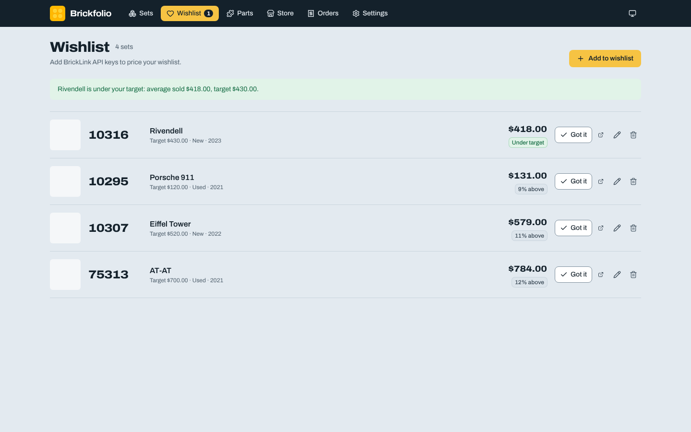

# Brickfolio

A self-hosted tracker for your brick-set collection: what you own, where it is, what condition it's in, and what it's worth based on what sets actually sell for on BrickLink. Your data stays on your server. It works on a phone and can be added to the home screen.



- **Collection:** set number, name, copies, location, condition (New / Used / Partial), missing %, notes.
- **Finish your Partial sets:** tick the parts a set is missing from its parts list; Missing % and value follow exactly, and the missing parts download as a BrickLink Wanted List.
- **Real sold prices:** BrickLink average, low and high sold prices for each set's condition, less missing pieces. A daily sync keeps them fresh and saves the history.
- **Set pages:** photo, value and price history, the full parts list with counts, notes, and the set's LDraw model in 3D with a step-by-step build view.
- **Wishlist:** sets you want and the price you'd pay; Brickfolio tells you when one sells for less (in the app, or by ntfy, Discord or any webhook), and "Got it" moves it into your collection.
- **Parts:** every set's parts from BrickLink, searchable across the whole collection.
- **Value vs. retail and a retirement watch** from Brickset (optional, free API key): each set's original price and your gain since, plus which sets you own or want are retiring soon.
- **Themes, minifigs and "What can I build?"** from Rebrickable (optional, with a free API key): alternate builds of your sets ranked by how many of their parts you own, with a BrickLink Wanted List for the rest.
- **Your BrickLink store:** inventory lots with asking value, and orders sold and bought.
- **Open and scriptable:** SQLite on your own server or Cloudflare D1, CSV import/export, and a REST API with tokens and an OpenAPI description.
- **Private by default:** behind Tailscale or Cloudflare Access, with no public login page to attack.

| Sets | Dark mode | On a phone | A set | Wishlist |
|---|---|---|---|---|
|  |  |  |  |  |

Screenshots use the demo data from `npm run seed`, so photos are blank and prices are illustrative. `scripts/screenshots.mjs` retakes them.

> LEGO® is a trademark of the LEGO Group, which does not sponsor, authorize or endorse this project.

## Install

| Setup | Good for | Files you need | Login |
|---|---|---|---|
| [Local only](docs/install.md#local-only) | Trying it out | `docker-compose.yml`, `.env` | None |
| [Docker + Tailscale](docs/install.md#docker--tailscale) | A home server or NAS, used from your own devices | `docker-compose.yml`, `compose.tailscale.yml`, `.env` | Your Tailscale account |
| [Docker + Cloudflare Tunnel](docs/install.md#docker--cloudflare-tunnel) | A home server, reachable from anywhere | `docker-compose.yml`, `compose.cloudflared.yml`, `.env` | Cloudflare Access (email code, Google, …) |
| [Cloudflare Workers + D1](docs/cloudflare.md) | No server at all (free plan works) | The whole repo | Cloudflare Access |

**[docs/install.md](docs/install.md)** has step-by-step instructions for each, including [BrickLink API keys](docs/install.md#get-your-bricklink-api-keys), [Portainer and other Docker GUIs](docs/install.md#portainer-dockge-synology-and-other-docker-guis), [updating](docs/install.md#updating) and [troubleshooting](docs/install.md#troubleshooting).

The Docker setups pull a ready-made image (`ghcr.io/scoobydrew83/brickfolio`, amd64 and arm64), so you only need the compose files and a `.env` on the server. Quick start on your own computer:

```bash
git clone https://github.com/scoobydrew83/brickfolio.git brickfolio && cd brickfolio
cp .env.example .env    # add your BRICKLINK_* keys
docker compose up -d    # then open http://127.0.0.1:3000
```

You'll want **BrickLink API keys** for prices (optional, but most of the point). See [how to get them](docs/install.md#get-your-bricklink-api-keys).

**Just looking?** Fill a database with 20 demo sets, 30 days of value history and a small wishlist, no keys needed:

```bash
npm ci && npm run seed && npm run dev   # http://localhost:3000
```

## Moving from Google Sheets

In Sheets, use **File → Download → Comma-separated values** on the Sets, History and Parts tabs. Then upload each file in **Settings → Import**, Sets first. Importing the Parts tab saves the BrickLink calls needed to fetch every set's parts list again. The original column names (`Lego #`, `Set Name`, `Est. Value`, …) are recognized, and locations that don't exist yet are created. Importing again updates sets by set number, so it's safe to repeat.

## Everyday use

- **Add Set:** looks the set up on BrickLink right away. Adding a set you already own asks before adding another copy.
- **Remove:** takes away one copy. On the last copy it deletes the set.
- **Sync BrickLink:** refreshes every set, then your store inventory and orders (it also runs daily at `SYNC_HOUR`). Progress shows on the button.
- **Set page:** click a set number or name for its photo, value history, parts list and notes.
- **Parts:** open a set's parts list from its card, or search every set's parts on the Parts page (e.g. which sets have a given part).
- **Wishlist:** add a set with the price you'd pay. Sets under your target go to the top; **Got it** moves one into your collection.
- **3D model:** on a set's page, upload its LDraw model (many are in the LDraw Official Model Repository) to orbit it or step through the build. Needs the LDraw parts library; see [the install guide](docs/install.md#optional-3d-models-of-your-sets).
- **Missing parts:** on a set's page, **Mark missing parts** and type how many of each are gone. The set becomes Partial, Missing % is worked out from the pieces, and **Wanted List** downloads them for BrickLink (Want → Upload). Refreshing the parts list keeps your marks.
- **What can I build?:** under Parts. Each build can download its missing parts as a BrickLink Wanted List.
- **Store** and **Orders:** your BrickLink store as of the last sync. Search and filter lots; switch between orders sold and bought.
- **Settings:** locations, currency, CSV import/export and API tokens.
- Search, filters and view are kept in the URL, so you can bookmark a view (e.g. your Sell list).

## Data and backups

- Docker keeps the database at `/data/app.db` in the `data` volume, and writes a copy to `/data/backups` daily (keeps `BACKUP_KEEP`, default 7).
- Restore by stopping the app and copying a backup over `app.db`.
- **Settings → Download all sets as CSV** gives a portable export at any time.

## API

Create a token in **Settings → API tokens**, then:

```bash
curl -H "Authorization: Bearer $TOKEN" https://your-host/api/v1/sets
curl -X POST -H "Authorization: Bearer $TOKEN" -H "Content-Type: application/json" \
  -d '{"setNo":"10280","name":"Flower Bouquet","condition":"Used"}' https://your-host/api/v1/sets
```

The full description is at `/api/v1/openapi.json` (OpenAPI 3.1): sets CRUD, lookup, parts lists, wishlist, sync, history, locations, store inventory, orders, import and export.

## Configuration

All settings are environment variables. See [`.env.example`](.env.example) for the full list with comments.

## Development

```bash
npm ci
cp .env.example .env.local
npm run dev            # http://localhost:3000, database in ./data/app.db
npm test               # unit and database tests (Vitest, in-memory SQLite)
npm run seed           # demo data in ./data/app.db (or DATABASE_PATH)
npm run lint
npm run db:generate    # after editing lib/db/schema.ts, writes a migration to ./drizzle
npm run cf:preview     # the app in the local Workers runtime with a local D1
```

How the code is laid out:

```
app/              pages, server actions (actions.ts) and the REST API (api/v1)
components/       pages' UI; shared components in components/ui (see docs/design.md)
lib/sets.ts       shared types, validation, filters and totals (no framework code)
lib/service/      collection logic used by actions, API and scheduler
lib/bricklink/    BrickLink API client with OAuth 1.0a signing
lib/rebrickable/  Rebrickable API client (themes, minifigs, alternate builds)
lib/ldraw/        LDraw parts library access for the 3D view (+ test fixtures)
lib/db/           Drizzle schema and drivers (better-sqlite3 locally, D1 on Cloudflare)
lib/auth.ts       auth modes: none, tailscale, cloudflare-access, plus API tokens
```

See [CONTRIBUTING.md](CONTRIBUTING.md) and the [Code of Conduct](CODE_OF_CONDUCT.md). The visual design system and roadmap are in [docs/design.md](docs/design.md).

## Credits

Brickfolio stands on other people's work:

- **Data:** [BrickLink](https://www.bricklink.com) for set details, parts lists and sold prices; [Rebrickable](https://rebrickable.com) for themes, minifigures and alternate builds; [Brickset](https://brickset.com) for retail prices and retirement dates; and [LDraw](https://www.ldraw.org) for the parts library and set models (CC BY 2.0, by the LDraw.org contributors). Each service is used with your own key and under its own terms. This app uses the BrickLink API but is not endorsed or certified by BrickLink.
- **Software:** [Next.js](https://nextjs.org), [React](https://react.dev), [three.js](https://threejs.org), [Drizzle ORM](https://orm.drizzle.team), [SQLite](https://sqlite.org) via better-sqlite3, [Lucide](https://lucide.dev) icons and the [Archivo](https://github.com/Omnibus-Type/Archivo) typeface (SIL OFL 1.1).

Every bundled package and its license is listed in [THIRD_PARTY_NOTICES.md](THIRD_PARTY_NOTICES.md); [NOTICE](NOTICE) has the trademark notes.

## License

[Apache License 2.0](LICENSE). See [NOTICE](NOTICE) for trademarks and data sources.
